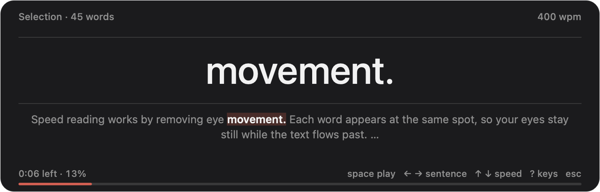

# Monoword

**Read anything on your Mac one word at a time.** Select text in any app, double-tap the right
⌘, and it plays in a small floating reader: each word appears in the same spot, so your eyes stay
still and the words come to you.



- **Works everywhere.** A post in the browser, an answer in the terminal, a PDF, a chat: if you
  can select it, you can speed-read it.
- **Real speed.** 500 wpm means 500 words a minute, pauses included, measured end to end.
- **Paced like reading.** Rare and long words get a little more time and tiny ones a little less,
  following eye-tracking research ([docs/PACING.md](docs/PACING.md)). Sentence ends get a beat.
- **Never lose your place.** Pause and the sentence around the word appears; ← jumps back a
  sentence.
- **Small and private.** A native menu bar app with no dependencies and no network access:
  nothing you read leaves your Mac.

## Install

**Download:** grab `Monoword.zip` from the
[latest release](https://github.com/Utkarsh-Mishra444/monoword/releases/latest), unzip it and move
`Monoword.app` to Applications. It runs on macOS 14 or later, on Apple silicon and Intel.

The app is free and not notarized by Apple, so the first time you open it macOS refuses
("Apple could not verify…"). Open **System Settings › Privacy & Security**, scroll down and click
**Open Anyway** next to Monoword, then confirm. (Or, in Terminal:
`xattr -dr com.apple.quarantine /Applications/Monoword.app`.)

On first launch Monoword asks for **Accessibility** (System Settings › Privacy & Security ›
Accessibility › Monoword on). It needs it to read the text you select and to notice the right-⌘
double tap. Without it, Monoword reads the clipboard instead, so copy (⌘C) first. It also adds
itself to Login Items; turn that off in Settings if you prefer.

**Build from source** (needs the Xcode Command Line Tools: `xcode-select --install`):

```sh
git clone https://github.com/Utkarsh-Mishra444/monoword && cd monoword
scripts/install.sh      # builds, installs ~/Applications/Monoword.app and starts it
```

Source builds are signed ad hoc, so each rebuild asks for Accessibility again. Run
`scripts/make-signing-identity.sh` once to keep the permission across rebuilds: it creates a
self-signed identity in its own keychain file under `.signing/` (gitignored; your login keychain is
not touched).

## Use

| Do this | To |
|---|---|
| select text, **double-tap right ⌘** | read the selection (two quick taps, nothing else pressed; left ⌘ and ⌘-shortcuts never trigger it) |
| select text, **⌃⌥R** | the same, as a regular shortcut (change it in Settings) |
| **⌃⌥V** | read what is on the clipboard |
| right-click selected text › Services › **Read with Monoword** | read without any shortcut or permission |
| menu bar › Resume Last | pick up a long text where you stopped |

In the reader:

| Key | Does |
|---|---|
| space (or click) | play / pause; paused shows the sentence around the word |
| ← → | back to the start of the sentence (again: the previous one) / next sentence |
| ⇧← ⇧→ | one word back / forward |
| ↑ ↓ | speed ±25 wpm (⇧ for ±100) |
| a, 1 2 3 | words per flash: **a**uto pairs two tiny words like it, a, is, to ("it is", "of the") and shows every word that carries meaning alone; or a fixed 1 to 3 |
| [ ] | text size |
| t | theme: dark, light, sepia |
| r | restart |
| ? | all keys |
| esc | close (focus returns to the app you were in) |
| scroll | scrub word by word |

Speed, pacing, theme, font and shortcuts are in Settings (menu bar › Settings…).

## How it works

- **Real speed.** The number is what you actually read: at 500 wpm a 500-word text takes one
  minute, pauses included. The words run faster than 500 to make room for the pauses at commas,
  sentence ends and paragraphs; on text dense with line breaks the pauses shrink instead. Tested
  end to end on prose, lists, posts and code at speeds 100 to 1500, pause settings 0 to 2, every
  grouping mode, from the start and from half way: within 1% with exact timing and within 2% on
  60 Hz and 120 Hz displays. Where a text cannot reach the speed on a display (long identifiers
  split into pieces on a 60 Hz screen), the reader shows the real maximum. (Settings › "Speed is
  real reading speed" off gives word-only speed, where pauses add time on top.)
- **Adaptive pacing** (on by default). Each word's time follows eye-tracking research: rarer
  words (from a 50,000-word frequency list) and longer words get a little more, common short
  words a little less, numbers by how many significant digits they have, a rare word less the
  second time it appears, and the word after a hard one a touch more. This moves time between
  words without changing the total. Sources and every number: [docs/PACING.md](docs/PACING.md).
- **Auto pairs.** Two tiny function words share a flash ("it is", "of the", "in a"); every word
  that carries meaning is shown alone.
- **Even rhythm.** Words change in step with the display's refresh: each is held for a whole
  number of frames and the rounding is carried into the next word, so the rhythm is steady (at 700
  wpm on a 60 Hz screen a plain word needs 5.14 frames; a free-running timer shows it for 5 or 6 at
  random, while the frame clock gave mostly 5 with a 6 every seventh word, measured on identical
  words).
- **Cleanup.** Terminal text is un-wrapped (hard line breaks, indents, box drawing, ANSI colours),
  PDF hyphenation is joined, Markdown markers are dropped (code is left alone), links show as their
  site name (`x.com`), long words and identifiers are split at syllables, humps and slashes, and
  lines a writer broke on purpose keep a short pause.
- **Reading the selection.** In order: ask the focused element for its selected text
  (Accessibility, no side effects); else press ⌘C for you, read it and put your old clipboard back
  (marked transient so clipboard managers skip the restore); else the clipboard as it is.

One word at a time is not free: studies of this kind of reading find literal comprehension drops
as speed rises, in part because the eyes cannot go back (details in
[docs/PACING.md](docs/PACING.md)). ← and the paused context view are there for exactly that.

## Troubleshooting

Monoword logs its decisions, never the text:
`log show --last 10m --predicate 'subsystem == "com.utkarshmishra.monoword"'` shows how the
selection was read (Accessibility, ⌘C or clipboard), whether the reader got the keyboard, and each
right-⌘ double tap.

## Automation

`monoword://read?text=…` (URL-encoded), `monoword://read?file=/path/to/file.txt`,
`monoword://selection`, `monoword://clipboard`, `monoword://resume`, `monoword://settings`.
For example: `open "monoword://read?file=$HOME/notes.txt"`.

## Develop

```sh
scripts/test.sh                 # core unit tests (swift-testing), including the real-speed grid
scripts/build-app.sh            # build/Monoword.app (MONOWORD_UNIVERSAL=1 for arm64 + x86_64)
build/Monoword.app/Contents/MacOS/Monoword --selftest /tmp/mw   # headless UI test + PNG frames
build/Monoword.app/Contents/MacOS/Monoword --selftest-live      # on-screen focus, rhythm and speed check
```

`Sources/MonowordCore` is the platform-free engine (cleaning, tokenizing, pacing, grouping, frame
timing, the reading cursor, the double-tap detector), unit tested. `Sources/MonowordApp` is the
AppKit shell.

## License

MIT, see [LICENSE](LICENSE). The bundled word-frequency list is CC BY-SA 4.0 (OpenSubtitles 2018
via [hermitdave/FrequencyWords](https://github.com/hermitdave/FrequencyWords)), see
[Resources/README.md](Resources/README.md).
